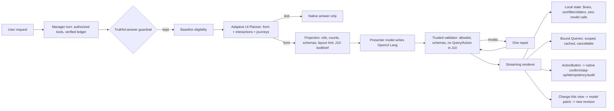

# Rafii Intelligent UI engine — architecture and acceptance contract (2026-10-15)

## 1. What already exists (audited 2026-10-14/15, origin/consumer-saas 0822c541)

Rafii's GenUI is already **model-composed, not template-selected**:

- A restricted *presenter* model writes an **OpenUI Lang program**. That is a typed, declarative component tree (`root = RafiiRoot([...])`) with:
  - statements, references and `$state` variables;
  - arithmetic, comparison, logical and ternary expressions;
  - `@Each` iteration;
  - two-way `$binding` props.
- The vocabulary is **primitives, not screens**:
  - layout: Stack, Grid, Section, Card, Tabs, Accordion;
  - states: Empty, Loading, Error;
  - data components bound to authorized Queries: table, chart, metric, timeline, comparison, task status, evidence link, selection list, asset preview, analytics family;
  - inputs: Form, TextField, Select, DateRange, Button;
  - registered writes: ActionButton.
- **The model controls composition:** which components, nesting, grouping, tabs and accordions, conditional sections (ternaries), which queries and with what `$state`-driven arguments, which local controls, and which registered actions to offer.
- **Trust boundary:**
  - the trusted parser and validator checks the component allowlist, prop schemas, binding names and limits (128 KiB source, 512 statements, depth 24);
  - generated `Mutation` is refused;
  - host actions are limited to `set`, `reset`, `run(query)`, `continue_conversation` and manifest-allowed in-app `open_url`;
  - writes happen only through ActionButton, then the native confirmation, step-up, idempotency and audit.
- **Streaming:** progressive SSE checkpoints, cancellation, retry with a cost note, persisted revisions and selection state.
- **"Change this view"** is a real, stateful model *patch* of the existing program: a new revision on the same artifact, with stale-revision protection. It does not insert a follow-up prompt. Only the *suggestion chips* prefill the instruction field.

## 2. Gaps against the mission (and the live G03 run, 2026-10-14)

| Gap | Evidence | Fix in this branch |
|---|---|---|
| A view requires workspace journey data, so "build a bill-split calculator" can never get a UI | eligibility `plain_answer` | **J10 Interactive tool** journey + "tool" plan form (workstream A) |
| No numeric or boolean inputs, no computed read-out | component catalogue | NumberField, Slider, Toggle, Readout (workstream A) |
| Deterministic keyword gate in front of the presenter; no response-form choice | audit | Adaptive UI Planner (PR #183, default off) + `context.layout` hint in active mode (commit 28be3654) |
| Chinese status answers replaced by the guardrail fallback, so no view | 4/8 live no-view cases | Guardrail requires an actor in Chinese, as in English (commit 0fe61357) |
| Hidden tab never notices a completed turn, so no presentation is requested | J07-b live | Client reconcile on visibility (workstream B) |
| Plain-answer turns that read only summary tools | J08-c, J08-e | Planner attention upgrade covers J08-c; J08-e is Manager tool choice (open) |
| First-pass parser rejections | J06-e, CMP-b (repaired) | Open: presenter prompt / parser analysis |

## 3. Pipeline (target)

## 4. Authority model (unchanged; generation never widens it)

| Class | Example | Model call | Business write | Enforcement |
|---|---|---|---|---|
| Local | slider, tab, sort, filter, toggle, readout recompute | none | none | renderer `$state`; host handler drops anything else |
| Read | refresh, next page, date-range change | none (data query only) | none | manifest bindings, member role, RLS, cancellation |
| Action | schedule, publish, apply a metadata change | none | only after human confirmation | ActionButton, then the native approval path. Generating a button is never approval |
| Adapt | "Change this view", "Try again" | yes (billed, explicit) | none | revision and idempotency keys, cost note first |

## 5. J10 privacy decision (new egress, flag-gated)

For J10 only, the presenter receives the person's own request text (`context.toolBrief`, at most 600 characters). Three conditions must all hold:
1. `RAFII_GENUI_TOOLS_ENABLED` is on (default off, fail-closed);
2. the turn read **no** workspace data;
3. the request goes to the same provider the parent turn already used.

J10 programs may contain no Query and no ActionButton; the server validator enforces this. **Activation needs owner approval.**

## 6. Acceptance contract

- **Blinded holdout:** `tests/fixtures/agent_ui/holdout_blinded_v1.json`, 60 cases written by an independent agent that never saw the planner or eligibility rules.
- **Offline (no model):** form and eligibility selection against the holdout's `expect.presentation`. Report agreement, inappropriate views, missed views, and the plain-text cases kept as text.
- **Live (paid):** needs a new owner-approved cap. G03 `g03-live-60/v2` plus the blinded holdout on a preview or canary, scored on the brief's 10 criteria. Rendering success is reported separately from functional action coverage.
- **Never:** change expectations after the fact, or report unrun tests as passing.
